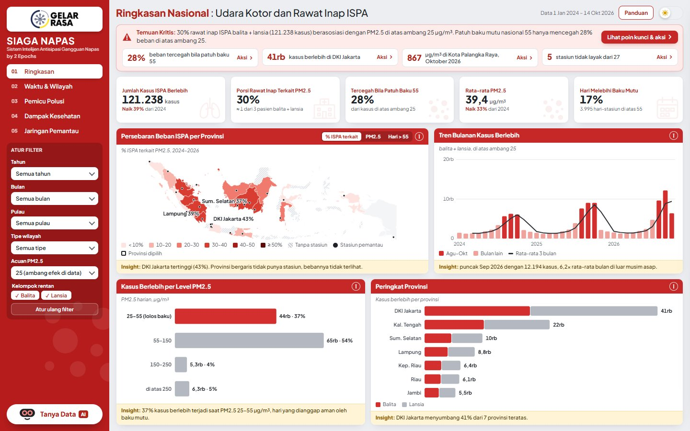
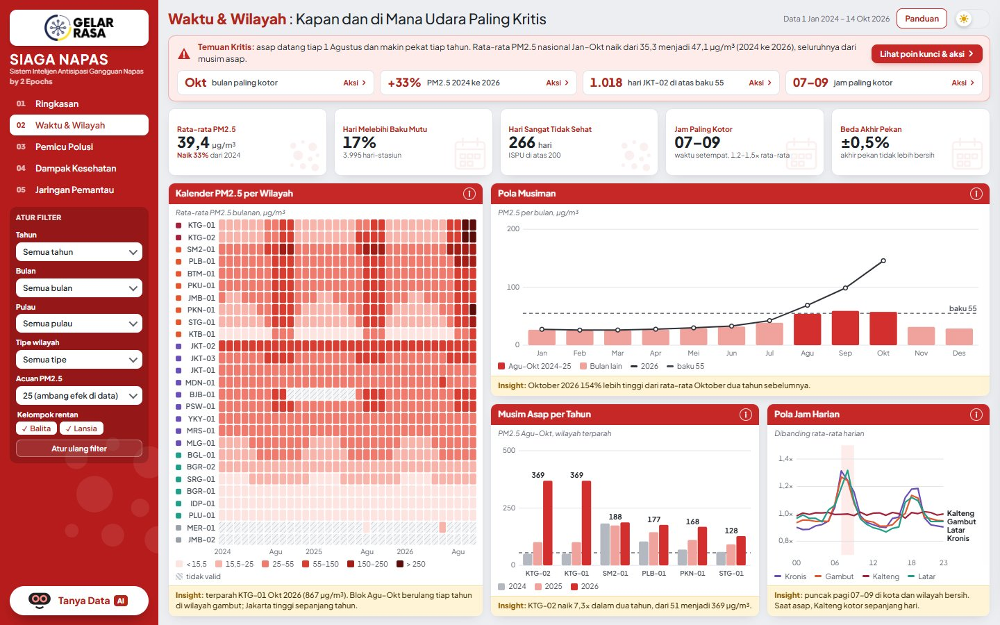
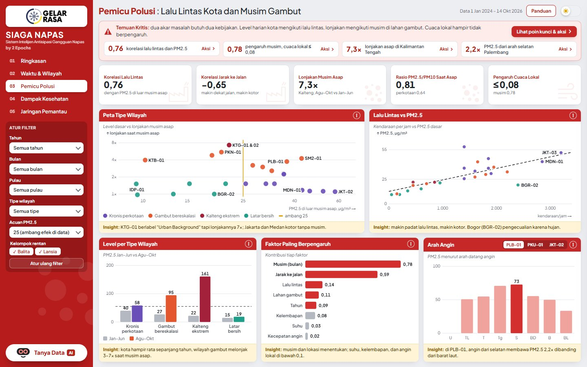
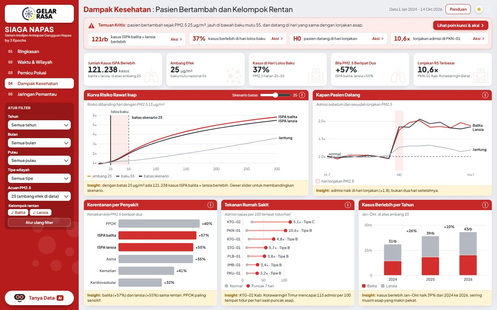
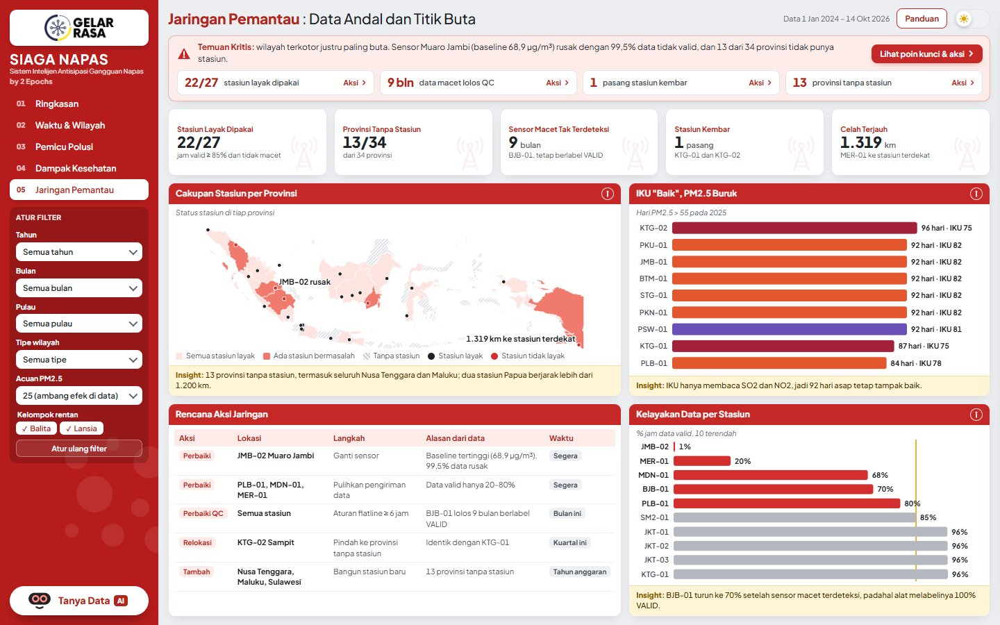

# SIAGA NAPAS

**Sistem Intelijen Antisipasi Gangguan Napas** · by 2 Epochs

Dashboard untuk melihat seberapa besar polusi udara PM2.5 menambah rawat inap ISPA pada balita dan lansia, di wilayah mana, pada bulan apa, dan apa yang sebaiknya disiapkan lebih dulu. 

Demo: https://sigap-napas.vercel.app



## Tentang proyek

Data yang dipakai ada dua: pengukuran kualitas udara per jam dari 27 stasiun AQMS di lima pulau, dan rawat inap harian di 27 rumah sakit rujukan, satu RS untuk tiap stasiun. Periodenya 1 Januari 2024 sampai 14 Oktober 2026.

Masalah yang mau dijawab sederhana. Baku mutu nasional baru menandai sebuah hari "bermasalah" saat PM2.5 melewati 55 µg/m³, padahal rawat inap sudah mulai naik sejak sekitar 25 µg/m³. Akibatnya banyak beban kesehatan terjadi pada hari yang secara aturan masih dianggap aman. SIAGA NAPAS menerjemahkan konsentrasi polutan menjadi jumlah pasien, lalu menjadi aksi untuk tim surveilans kesehatan lingkungan (Kemenkes dan Dinkes) serta pengelola jaringan pemantau (KLH dan DLH).

Fokusnya PM2.5 karena itu polutan penentu ISPU pada 99,7% hari valid dan yang paling jelas kaitannya dengan penyakit pernapasan. Polutan lain tetap dipakai sebagai petunjuk sumber.

## Temuan utama

- Sekitar sepertiga rawat inap ISPA balita (33%) dan lansia (31%) berasosiasi dengan PM2.5 di atas 25 µg/m³. Totalnya 121.238 kasus berlebih, terdiri dari 56.354 balita dan 64.883 lansia.
- Efek mulai terlihat di 25 µg/m³, bukan di 55. Sebanyak 36% kasus berlebih terjadi pada hari yang lolos baku mutu harian. Mematuhi baku 55 saja hanya mencegah sekitar 28% beban.
- Polusi punya dua wajah. Kota besar kotor sepanjang tahun karena lalu lintas. Wilayah gambut diselimuti asap tiap Agustus sampai Oktober dan makin parah setiap tahun, dengan rata-rata nasional Januari sampai Oktober naik dari 35,3 ke 47,1 µg/m³ dan puncak 867 µg/m³ di Kalimantan Tengah pada Oktober 2026.
- Pasien datang di hari yang sama dengan lonjakan, bukan beberapa hari sesudahnya. Setiap PM2.5 berlipat dua, rawat inap balita naik sekitar 57% dan lansia sekitar 55%.
- Jaringan pemantau belum memadai. Ada 5 dari 27 stasiun yang datanya tidak layak, dua stasiun kembar di Kotawaringin Timur, 13 dari 34 provinsi tanpa stasiun, dan IKU yang tidak membaca PM2.5.

## Isi dashboard

Ada lima halaman dengan filter yang sama dan tersimpan saat pindah halaman.

| Halaman | Pertanyaan yang dijawab |
|---|---|
| Ringkasan | Seberapa besar beban rawat inap akibat udara kotor, di provinsi mana paling berat, dan berapa yang bisa dicegah |
| Waktu & Wilayah | Kapan dan di mana udara paling kritis: bulan, tahun, dan jam |
| Pemicu Polusi | Faktor apa yang menentukan level dan lonjakan PM2.5 |
| Dampak Kesehatan | Berapa pasien bertambah, siapa paling rentan, kapan mereka datang, dan RS mana paling tertekan |
| Jaringan Pemantau | Stasiun mana yang datanya bisa dipercaya dan mana yang perlu diperbaiki, dipindah, atau ditambah |






### Fitur

- **Filter global**: tahun, bulan, pulau, tipe wilayah, acuan PM2.5 (55, 25, atau 15), dan kelompok rentan. Acuan PM2.5 berfungsi sebagai simulasi kebijakan.
- **Temuan Kritis dan Poin Kunci**: empat angka di tiap halaman yang bisa diklik untuk melihat apa yang terjadi, kenapa penting, siapa yang bertindak, dan aksinya.
- **Peta choropleth** 34 provinsi, klik provinsi untuk melihat profil stasiunnya.
- **Slider skenario** pada kurva risiko untuk menghitung ulang kasus berlebih pada batas yang berbeda.
- **Tombol i** di tiap grafik berisi cara membacanya, dan **Panduan** berisi penjelasan lengkap dengan screenshot bernomor.
- **Mode terang dan gelap**, serta tampilan yang menyesuaikan layar desktop sampai ponsel.
- **Tanya Data AI**, asisten untuk pertanyaan yang tidak ada di grafik (lihat bagian berikutnya).

### Tanya Data AI

Pengguna bertanya dengan bahasa sehari-hari, misalnya "RS mana paling tertekan saat musim asap 2026?" atau "Bandingkan PM2.5 Jakarta Pusat dan Palangka Raya per tahun". Jawabannya datang bersama grafik.

Cara kerjanya dibuat supaya angka tidak mengarang:

- Model bahasa tidak pernah menulis SQL. Ia hanya memilih satu dari beberapa tool terdefinisi (ringkasan KPI, peringkat, tren, profil stasiun, dan sebagainya), lalu aplikasi menjalankan kueri berparameter ke datamart.
- Setiap angka di jawaban dicocokkan dengan hasil kueri. Angka yang tidak ketemu ditandai.
- Grafik dibuat dari hasil kueri, bukan digambar oleh model. Riwayat percakapan tersimpan di database.
- Pertanyaan di luar cakupan data ditolak dengan sopan.

Penyedia modelnya bisa diganti lewat env, OpenAI atau DeepSeek. Dari uji dengan `gpt-5.6-terra`, biayanya sekitar US$0,014 per pertanyaan.

## Metode singkat

| Tahap | Yang dilakukan |
|---|---|
| Pembersihan | Kode error dan nilai mustahil dibuang, jam alat disinkronkan, satuan ppm dikonversi ke µg/m³, sensor macet (nilai sama 6 jam atau lebih padahal berlabel VALID) ditandai. Hanya data VALID yang dihitung, dan hari dianggap valid bila punya minimal 18 jam data. |
| Kasus berlebih | Poisson GLM dengan efek tetap RS, spline log PM2.5, hari dalam pekan, suhu, dan tahun. Kasus berlebih adalah selisih prediksi pada PM2.5 aktual dengan prediksi bila PM2.5 dibatasi di nilai acuan. |
| Tipe wilayah | k-means pada profil bulanan PM2.5 menghasilkan empat tipe: kronis perkotaan, gambut bereskalasi, ekstrem, dan latar bersih. |
| Faktor pemicu | Gradient boosting dengan permutation importance. |
| Kelayakan stasiun | Persentase jam valid (batas layak 85%) dan deteksi sensor macet. |

Dashboard sengaja tidak memakai peramalan. Angkanya adalah asosiasi dari data yang ada, bukan sebab-akibat, dan datanya sintetis. Tidak ada data eksternal yang dipakai. Batas provinsi di peta (BAKOSURTANAL 1:250.000) hanya latar visual.

## Teknologi

- **Web**: Next.js 16 (App Router), React 19, TypeScript, Zustand. Grafik digambar sendiri dengan SVG dan CSS murni tanpa pustaka grafik.
- **Data**: Python (pandas, statsmodels, scikit-learn), hasilnya disimpan sebagai CSV dan Parquet.
- **Database**: PostgreSQL 15+ (Supabase di production), schema `mart` untuk datamart dan `app` untuk riwayat chat.
- **AI**: SDK `openai` dengan penyedia OpenAI atau DeepSeek.
- **Deploy**: Vercel.

## Struktur folder

```
.
├── analysis/        pipeline Python: pembersihan, agregasi, model, ekspor
├── assets/
│   ├── geo/         GeoJSON batas provinsi untuk latar peta
│   └── screenshots/ gambar untuk README
├── datamart/        schema.sql, pemuat PostgreSQL, tabel CSV dan Parquet hasil build
└── web/             aplikasi Next.js (dashboard dan API Tanya Data)
    ├── public/      dashboard.json, logo, screenshot Panduan
    ├── scripts/     uji semantic layer, pembantu env, pembuat screenshot Panduan
    └── src/
        ├── app/         halaman dan route API
        ├── components/  kerangka, halaman, dan grafik
        ├── lib/         konten, filter, agregasi, kit grafik SVG
        └── server/      semantic layer, LLM, dan riwayat chat
```

## Cara menjalankan

### 1. Dashboard saja

Data dashboard sudah ada di `web/public/data/dashboard.json`, jadi tidak perlu database untuk melihat lima halamannya.

Prasyarat: Node.js 20 atau lebih baru (diuji di 22).

```bash
cd web
npm install
npm run dev
```

Buka http://localhost:3000. Tanpa database, Tanya Data akan membalas bahwa ia belum bisa menjawab, sedangkan halaman dashboard tetap berfungsi normal.

### 2. Dengan Tanya Data

Butuh PostgreSQL 15+ dan satu kunci API (OpenAI atau DeepSeek).

Buat database lalu muat datamart. Tabel hasil build sudah ada di `datamart/data/`.

```bash
createdb siaga
export DATABASE_URL=postgresql://$USER@localhost:5432/siaga

# pilih salah satu
bash datamart/load_psql.sh               # hanya butuh psql
python datamart/load_postgres.py         # butuh paket psycopg
```

Pemuatan aman diulang. Isi schema `mart` diganti, riwayat chat di schema `app` tidak disentuh. Hasil yang benar berakhir dengan validasi `56354 | 16215` dan view `mart.v_station_month` berisi 918 baris.

Lalu siapkan env untuk web.

```bash
cd web
cp .env.example .env
# isi .env, lalu
npm run dev
```

| Variabel | Keterangan |
|---|---|
| `DATABASE_URL` | Connection string PostgreSQL dari langkah di atas |
| `LLM_PROVIDER` | `openai` atau `deepseek` |
| `OPENAI_API_KEY`, `OPENAI_MODEL` | Untuk provider `openai`. `OPENAI_MODEL` harus ID API persis dari akun (contoh `gpt-5.6-terra`, tanpa awalan `openai.`) dan mendukung Chat Completions dengan tool calling |
| `LLM_REASONING_EFFORT` | Isi `none` untuk seri gpt-5.x supaya tool diterima. Kosong berarti otomatis `none` untuk model tersebut |
| `LLM_TEMPERATURE` | Opsional. Kosongkan untuk model reasoning yang menolak parameter ini |
| `OPENAI_BASE_URL` | Opsional, untuk gateway yang kompatibel dengan OpenAI |
| `DEEPSEEK_API_KEY`, `DEEPSEEK_MODEL`, `DEEPSEEK_BASE_URL` | Untuk provider `deepseek` (bawaan `deepseek-chat` dan `https://api.deepseek.com`) |

Untuk menguji semua tool semantic layer langsung ke database tanpa model bahasa:

```bash
cd web
DATABASE_URL=postgresql://$USER@localhost:5432/siaga npm run test:tools
```

### 3. Menjalankan ulang pipeline data (opsional)

Hanya perlu kalau data mentah berubah. Data mentah panitia tidak ikut di repo. Taruh foldernya dengan nama `Dataset DA Gelar Rasa 2026/` di root repo, atau arahkan dengan variabel `DATA_DIR`.

Prasyarat: Python 3.12.

```bash
python -m venv analysis/.venv
source analysis/.venv/bin/activate        # Windows: analysis\.venv\Scripts\activate
pip install -r analysis/requirements.txt

python analysis/01_clean.py               # data per jam bersih dan log kualitas data
python analysis/02_daily.py               # grain stasiun-RS per hari
python analysis/03_health_model.py        # Poisson GLM dan kasus berlebih
python analysis/04_network_cluster.py     # jarak, redundansi, tipe wilayah
python analysis/06_export_dashboard.py    # tulis web/public/data/dashboard.json
python analysis/07_build_datamart.py      # tulis datamart/data/*.csv dan *.parquet
```

`00_profile_raw.py` adalah profil data mentah (skema, duplikat, rentang nilai) dan boleh dilewati. Skrip 07 membaca `dashboard.json` yang dihasilkan skrip 06, jadi urutannya jangan ditukar. Keluaran antara disimpan di `analysis/out/` yang tidak ikut di git. Setelah selesai, muat ulang datamart seperti di langkah 2.

### Perintah web

| Perintah | Fungsi |
|---|---|
| `npm run dev` | Server pengembangan |
| `npm run build` lalu `npm start` | Build dan jalankan versi production |
| `npm run lint` | ESLint |
| `npm run typecheck` | Cek TypeScript. Jalankan sesudah `build` karena sebagian tipe dibuat otomatis oleh Next |
| `npm run test:tools` | Uji semantic layer ke database |

Screenshot di Panduan dibuat oleh `web/scripts/guide_shots.py` (butuh Playwright dan Pillow, serta server yang sedang jalan). Jalankan ulang kalau tata letak berubah.

## Deploy

Aplikasi berjalan di Vercel dengan database di Supabase.

1. **Supabase**: buat project, lalu muat datamart dengan Session pooler (port 5432), misalnya `DATABASE_URL='<session-pooler-uri>' bash datamart/load_psql.sh`. Connection string langsung (`db.<ref>.supabase.co`) hanya IPv6 sehingga tidak cocok untuk Vercel.
2. **Vercel**: import repo dan set **Root Directory** ke `web`.
3. **Environment Variables**: `DATABASE_URL` diisi Transaction pooler (port 6543, tambahkan `?sslmode=require`), ditambah `LLM_PROVIDER`, `OPENAI_API_KEY`, dan `OPENAI_MODEL`. Aplikasi sudah mematikan prepared statement sehingga cocok dengan Transaction pooler.
4. **Function Region** di Vercel disamakan dengan region Supabase supaya kueri tidak menyeberang benua.

Halaman dashboard tetap tampil walau database atau API model bermasalah. Yang bergantung pada keduanya hanya Tanya Data. Project Supabase gratis akan di-pause setelah 7 hari tanpa aktivitas dan perlu di-restore dari dashboard Supabase.

## Tim

2 Epochs
